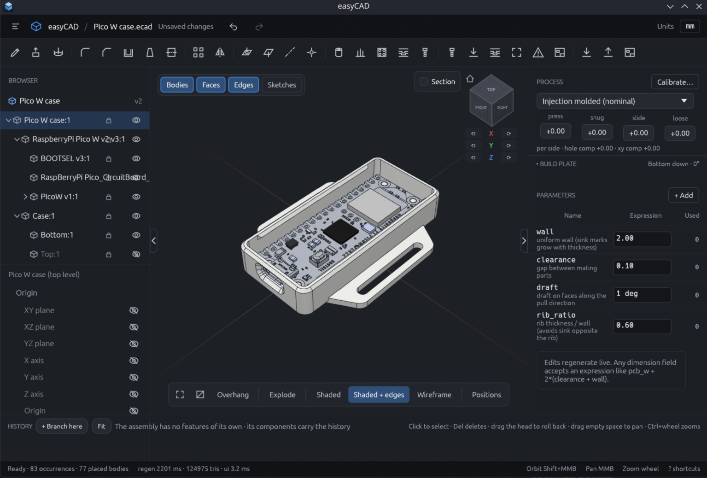

# easyCAD

**Fast, powerful, parametric CAD that Claude can drive.** Sketch, constrain, extrude, fillet,
assemble and draw, on the OpenCascade B-rep kernel, in a native app that stays smooth on a laptop.
Fully offline. macOS, Linux and Windows. LGPL-2.1.


<sub>Pico W case model © Adafruit Industries, MIT ([Adafruit_CAD_Parts](https://github.com/adafruit/Adafruit_CAD_Parts)).</sub>

- **Fast.** 120+ fps in the viewport even on a MacBook Air (M4, 16 GB). Native Rust with a
  wgpu renderer, one self-contained binary, no installer, no cloud round-trips.
- **Powerful.** A full parametric modeler: constrained sketches, solid and face features,
  branchable history, assemblies with mates and motion, 2D drawings, and manufacturing-aware
  fits that general CAD tools leave out.
- **Convenient.** A built-in MCP server lets Claude Code work in the open window: read the
  model, change parameters, add sketches and features, measure, check clearances, and export,
  while you watch.

## Download

Prebuilt zips for macOS (universal), Linux x86_64 and Windows x86_64 are on the
[Releases](https://github.com/CharlesMod/easyCAD/releases) page. Unzip and run.
The builds are unsigned: on macOS, right-click the app and choose **Open** the first time; on
Windows, SmartScreen needs **More info → Run anyway**. The Windows build is new and lightly tested.

## Fast

- 120+ fps orbiting and editing on a MacBook Air M4 (16 GB), on the integrated GPU.
- Parameter edits regenerate live, with a regeneration cache, so only what changed is rebuilt.
  Undo is instant.
- A native app: Rust, egui and wgpu (Metal, Vulkan, DirectX), with OpenCascade statically linked.
  It works without a network connection and keeps your files on your disk.
- Autosave with crash recovery runs off the UI thread, so saving never stalls the view.

## Powerful

### Modeling
- **Sketches** with lines, arcs, circles, points and construction geometry, and a constraint
  solver that shows how many degrees of freedom remain: coincident, horizontal/vertical, parallel,
  perpendicular, tangent, equal, midpoint, symmetric, fix, distances, length, radius, diameter,
  angle and offset. Inline dimensions, snapping, trim, offset and move.
- **Projected geometry** that stays linked: projected edges and face outlines follow their source.
- **Features:** extrude and revolve (pick sketch regions directly), fillet, chamfer, shell, draft,
  ribs, screw bosses, linear and circular patterns, mirror, split, and datum planes, axes and points.
- **Face edits that stay in the history:** click a face to fillet every edge around it, extrude a
  face (drag up to join, down to cut), or delete faces and let the model heal.
- **Self-healing fillets and chamfers:** they retry by tangent chain, reorder failed sets and find
  the largest radius that fits. You always get a valid solid plus a report
  ("1 edge maxes out at 1.99 → Use 1.99 / Skip").
- **Parameters everywhere:** type `=expression` in any field.
- **History you can branch:** roll the timeline back, branch off an experiment, preview the
  difference, then keep it or throw it away.
- **Mesh bodies:** import STL, OBJ or GLB/glTF and combine them with solid bodies.

### Assemblies
- Components and subcomponents, instances, linked `.ecad` files, and in-context design.
- Mates: rigid, revolute, slider, cylindrical, planar and ball, with a jog slider and a move gizmo.
- **Positions:** save named states of an assembly and play the motion between them.
- Interference check (shows the overlapping solid), explode slider, and an indented or flat BOM
  with CSV export.

### Made for making things
- **Process profiles** for FDM, SLA, SLS, molding and CNC. Mark a dimension `hole · slide` or
  `pin · snug` (press, snug, slide, loose) instead of typing `wall - printtol/2`. The profile
  supplies the allowance.
- **Teardrop holes** for FDM, oriented against your build plate, and an **overhang heat map** of
  faces that need support. A **calibration coupon** feeds measured fits back into the profile.
- **Parting joints** from a draggable split plane: tongue and groove, lip, O-ring gland (squeeze
  and fill checked against AS568 and metric cords), and snap fits (strain checked per material).
- **Parts library:** metric and imperial screws, nuts, washers, heat-set inserts, standoffs,
  magnets and feet, each with its clearance, counterbore, tap and pilot hole rules.

### Viewing
- A pick stack under the cursor (Tab cycles through hidden faces), a full view cube (26 regions,
  15° steps, home), and navigation presets for Fusion, SolidWorks, Onshape and Blender.
- Section view: the kept half is solid with the cut tinted, and the cut-away half is drawn as a
  wireframe for context.
- Shaded, shaded with edges, and wireframe modes; inch or millimetre display. Panes collapse to
  fit half a laptop screen.

### Drawings, import and export
- **2D drawings:** views by cube face, iso corner or any rotation; associative dimensions, notes,
  balloons, a BOM table and a title block. Export as PDF, DXF or SVG.
- **Import:** STEP, DXF, STL, OBJ, GLB/glTF.
- **Export:** STEP, STL and 3MF, for parts or whole assemblies.

## Convenient: Claude in the loop

Turn on the MCP bridge (`easycad --mcp`, or a toggle in Settings) and Claude Code can model in
the window you have open. It can:

- read the document, its parameters and your current selection;
- set parameters, add sketches and features, edit or delete them, import meshes, and undo;
- measure, check interference and clearance, and save assembly positions;
- take its own screenshots, contact sheets and sections, without moving your view;
- open, save and export files.

Your edits and Claude's go into the same history, so everything it does is visible and undoable.
The server listens on `127.0.0.1` only, behind a token. Install the Claude Code plugin from
`tools/claude-plugin`; see [docs/MCP.md](docs/MCP.md).

Optional **Google Drive sync** keeps documents, the parts library and settings in your own Drive
(local-first, three-way, with conflict copies). It needs your own OAuth client; see
[crates/sync/README.md](crates/sync/README.md).

## Bonus: enclosures from a PCB

easyCAD began as an enclosure tool, and that's still built in. Import an EasyEDA board STEP
(with colors and part names) and outline DXF, and **New enclosure from PCB** builds a complete
parametric enclosure in one step: shell, standoffs on the mounting holes, a parting joint, and
cut-outs where connectors poke through.

## Build from source

```bash
cargo run -p easycad --release -- --sample
```

You need Rust, CMake and a C++17 compiler. The first build compiles OpenCascade 7.8 (about 20 min).
`scripts/build-release.sh` builds the release zips for all three platforms; see
[docs/BUILDING.md](docs/BUILDING.md).

| path | what |
|---|---|
| `crates/occt` | cxx bridge to a narrow C++ shim over OpenCascade 7.8 |
| `crates/model` | documents, parameters and expressions, sketch solver, features, regeneration, datums, history branches, mesh bodies, joints, process profiles, parts library, assemblies, drawings, import/export |
| `crates/app` | the desktop app (`easycad` binary), with snapshot and click-through (`e2e/`) tests |
| `crates/mcp` | the MCP server and the `easycad-mcp` stdio shim |
| `crates/sync` | Google Drive sync: OAuth (PKCE, keychain), Drive v3 client, sync engine |
| `tools/claude-plugin` | Claude Code plugin for the MCP bridge |
| `docs/` | `GUI.md`, `ENGINE.md`, `MCP.md`, `BUILDING.md` and design notes |

Documents are `.ecad` folders (`doc.json` plus content-addressed `blobs/`). Older `.cwk` folders
still open.

## License

[LGPL-2.1-only](LICENSE), matching OpenCascade (LGPL-2.1 with an additional exception; see
[licenses/OCCT_LGPL_EXCEPTION.txt](licenses/OCCT_LGPL_EXCEPTION.txt)). Release packages include
`THIRD-PARTY-NOTICES.html` with every bundled dependency's license.

Issues and pull requests are welcome at
[github.com/CharlesMod/easyCAD/issues](https://github.com/CharlesMod/easyCAD/issues).
